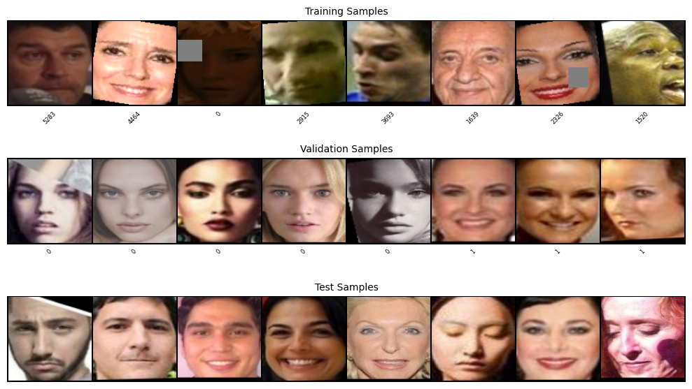
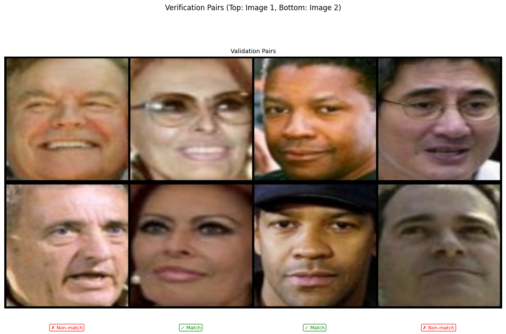
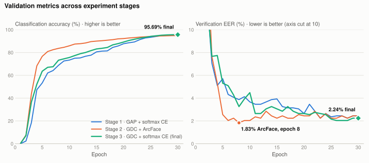

# Face Classification and Verification with a ResNet-34 Built from Scratch

**CMU 11-785 Introduction to Deep Learning · Fall 2026 · Homework 2, Part 2 (Kaggle)**

A ResNet-34 convolutional network, implemented from basic PyTorch layers and trained from random
initialisation, that maps a 112 × 112 face image to a 512-dimensional **face embedding**. The
model is trained to name 8,631 known identities. The same embedding is then reused, without
retraining, to decide whether two faces belong to the same person, including people never seen
during training. The final model has 26.16 M parameters and reaches a combined score of
**96.864 on the Kaggle private leaderboard** (96.732 public, 96.72 on validation: 95.69 %
classification accuracy and 2.24 % verification EER).

<p align="left">
  
  
  
  
  
</p>

---

## Contents

1. [Problem](#problem)
2. [Dataset](#dataset)
3. [Approach](#approach)
4. [Architecture](#architecture)
5. [Training](#training)
6. [Results and experiment history](#results-and-experiment-history)
7. [Repository structure](#repository-structure)
8. [Reproducing the results](#reproducing-the-results)
9. [Acknowledgements](#acknowledgements)

---

## Problem

Face recognition systems answer two related questions:

- **Classification (closed set):** *Who is this?* The image is assigned to one of a fixed list of
  identities that the model saw during training.
- **Verification (open set):** *Are these two images the same person?* No identity label is
  needed, and the people in the test pairs do not have to appear in the training set.

The two tasks are linked through the embedding. A network trained to classify identities learns
a compact feature vector for each face. If that vector space is well organised, images of one
person sit close together and images of different people sit far apart, so a similarity score
between two embeddings answers the verification question. The assignment shows the limits of
that link: higher classification accuracy does not by itself guarantee better verification.

The assignment fixes the following constraints:

| Constraint | Value |
|---|---|
| Model family | Any CNN, implemented from basic PyTorch operations (`Conv2d`, `Linear`, …) |
| Parameter budget | **< 30 M** parameters |
| Pre-trained weights | Not allowed |
| External data | Not allowed |
| Metric | `0.5 × classification accuracy + 0.5 × (1 − EER)` on hidden test sets, both terms as fractions (the leaderboard shows the score × 100) |

The **Equal Error Rate (EER)** is the error at the similarity threshold where the false-accept
rate equals the false-reject rate. Lower is better.

## Dataset

The competition provides aligned face crops as JPEG files at 112 × 112 RGB, split into a
classification set and a verification set.

| Split | Images / pairs | Labels | Used for |
|---|---:|---|---|
| `cls_data/train` | 431,550 images · 8,631 identities | ✔ identity | Training |
| `cls_data/dev` | 43,097 images · same 8,631 identities | ✔ identity | Validation accuracy |
| `cls_data/test` | 43,097 images | — (Kaggle) | Classification half of the score |
| `val_pairs.txt` | 1,000 pairs | ✔ match / non-match | Validation EER |
| `test_pairs.txt` | 5,000 pairs | — (Kaggle) | Verification half of the score |

The training set averages exactly 50 images per identity (431,550 / 8,631).

### From face photo to model input

1. **Decode.** Each JPEG is decoded to an RGB tensor and scaled from 0–255 to [0, 1].
2. **Augment (training only).** Random transformations simulate the variation a recogniser has
   to ignore: framing and scale, mirror image, lighting and colour cast, head tilt and partial
   occlusion (details under [Approach](#approach)).
3. **Normalise.** Each channel is mapped to [−1, 1] with mean 0.5 and standard deviation 0.5.
4. **Batch.** 256 images form a `256 × 3 × 112 × 112` tensor.

What separates identities is fine facial structure: the shape and spacing of the eyes, brows,
nose and mouth, and the texture around them. Pose, lighting, expression, make-up, glasses and
image quality all change the pixels without changing the identity. The network has to become
sensitive to the first group and invariant to the second. Augmentation targets the second group
directly.

### What the model sees

<p align="center">
  
</p>

The image above shows one batch from each classification loader, de-normalised for display. The
number under each training and validation image is its identity index. The **training row** shows
augmentation at work: the grey rectangles come from random erasing, the black wedges at the
corners from small rotations. The very dark third image is most likely darkened by colour
jitter (brightness and contrast). The validation and
test rows are only resized and normalised.

<p align="center">
  
</p>

Verification pairs from `val_pairs.txt`. The two matching pairs (centre) show how much one
identity can vary between photos: glasses on and off, a cap, a different expression and
lighting. The model must still score these pairs higher than the non-matching pairs.

## Approach

The core idea is **transfer from classification to verification**. One network is trained with an
ordinary identity classifier. The classifier is then removed and only the 512-d embedding is used
for verification. Each image of a pair goes through the shared encoder separately; the embeddings
are L2-normalised and compared by cosine similarity. Because both halves of the score come from the
same embedding, the checkpoint is chosen with the competition's own combined metric, not with
accuracy alone.

The full pipeline:

1. **Augment for invariance (training only).** Random resized crop (scale 0.75–1.0, aspect
   0.9–1.1) for detector jitter. Horizontal flip (p = 0.5), because a mirrored face is the same
   person. Colour jitter (p = 0.5) and random greyscale (p = 0.05), so the model cannot use skin or
   hair colour as a shortcut. Rotation of ±10° (p = 0.3) for head tilt. Random erasing
   (p = 0.25, 2–15 % of the image) as a stand-in for occlusion. There are no vertical flips or large
   rotations, because upside-down faces never occur at test time.
2. **Encode.** A ResNet-34 adapted to 112 × 112 inputs produces a 512-d embedding (see
   [Architecture](#architecture)).
3. **Classify (training signal).** A linear layer maps the embedding to 8,631 identity logits,
   trained with softmax cross-entropy and label smoothing 0.1.
4. **Verify (inference).** The pair's embeddings are L2-normalised and compared by cosine
   similarity. The score goes to Kaggle directly; the EER is computed from it.
5. **Select.** After every epoch the model is scored on validation accuracy and validation EER.
   The checkpoint with the best `0.5 × accuracy + 0.5 × (100 − EER)` is submitted.

## Architecture

<p align="center">
  
</p>

The backbone is a ResNet-34 (BasicBlocks in a 3-4-6-3 layout) with two changes for small face
crops. The standard ImageNet stem (7 × 7 stride-2 convolution plus max-pool) shrinks the image 4×
before the first residual block. Here a **3 × 3 stride-1 stem** keeps the full 112 × 112 resolution,
and every stage downsamples by 2 instead, so the network still reduces the resolution 32× in total
(112 → 56 → 28 → 14 → 7). Each residual block, as trained, is:

```
x ─► Conv3×3 → BN → ReLU → Conv3×3 → BN (γ = 0 at init) → SE ─► (+) ─► ReLU
└──────────────── identity, or 1×1 conv stride 2 + BN at stage entry ──┘
```

**SE** is a Squeeze-and-Excitation module: global average pooling, a 1 × 1 convolution to
max(C/16, 8) channels, ReLU, a 1 × 1 convolution back to C channels and a sigmoid. It rescales
each channel of the residual branch. The diagram above does not draw it, but it is part of every
block in the trained model (`use_se` defaults to `True` in the notebook) and is included in the
parameter counts below.

| Component | Output shape (C × H × W) | Parameters |
|---|---|---:|
| Stem: Conv 3×3, stride 1 + BN + ReLU | 64 × 112 × 112 | 1,856 |
| Stage 1: 3 BasicBlocks + SE | 64 × 56 × 56 | 229,464 |
| Stage 2: 4 BasicBlocks + SE | 128 × 28 × 28 | 1,125,152 |
| Stage 3: 6 BasicBlocks + SE | 256 × 14 × 14 | 6,873,184 |
| Stage 4: 3 BasicBlocks + SE | 512 × 7 × 7 | 13,214,304 |
| GDC: depthwise Conv 7×7 (512 groups) + BN | 512 | 26,112 |
| Embedding: Dropout 0.3 → Linear 512→512 (no bias) → BN1d | 512 | 263,168 |
| *Backbone subtotal* | | *21,733,240* |
| Classifier: Linear 512→8,631 (training only) | 8,631 | 4,427,703 |
| **Total** | | **26,160,943** |

The counts include BatchNorm affine parameters and the SE layers (162,744 in total), and they
match the total recorded in [`model_metadata.json`](submission_artifacts/model_metadata.json).

**Design choices**

- **Full-resolution stem, no max-pool.** At 112 px, fine texture around the eyes, nose and mouth
  carries much of the identity signal. Downsampling it away in the first layer would discard
  information that later layers cannot recover.
- **Global depthwise convolution (GDC) instead of global average pooling.** The faces are aligned,
  so position is informative: an eye-corner feature means something different at the edge of the
  map than at its centre. GDC learns one 7 × 7 spatial weighting per channel (49 weights) for
  26 K extra parameters, where average pooling weights all positions equally.
- **BatchNorm on the embedding.** The 512-d output is batch-normalised so feature scales are
  comparable across images before cosine comparison.
- **Zero-initialised last BN in every residual branch.** Each block starts as an identity mapping,
  which keeps early training of the 34-layer network stable.
- **Kaiming-normal initialisation** (fan-out, ReLU) for all convolutions.
- **Budget use.** At 26.16 M parameters the model uses 87 % of the 30 M limit. 4.43 M of those sit in
  the classifier, which is used only during training.

## Training

| Setting | Value |
|---|---|
| Loss | Softmax cross-entropy, label smoothing 0.1 |
| Optimiser | SGD, momentum 0.9, Nesterov, lr 0.1 |
| Weight decay | 5e-4 on convolution and linear weights only (BatchNorm parameters and biases exempt) |
| LR schedule | Linear warm-up from 0.01 over 2 epochs, then cosine decay to 1e-5 |
| Batch size | 256 |
| Epochs | 30 (best combined-score checkpoint kept) |
| Precision | Automatic mixed precision (fp16 autocast + `GradScaler`) |
| Gradient clipping | Global norm 3.0 (applied after unscaling) |
| Augmentation | Random resized crop, horizontal flip, colour jitter, greyscale, rotation, random erasing |
| Hardware | NVIDIA Tesla T4 (Kaggle) |
| Tracking | Weights & Biases (loss, accuracy, LR, EER, AUC, TPR at fixed FPR) |

After every epoch the loop saves `last.pth` and separate best checkpoints for classification
accuracy, verification accuracy and the combined score, each with model, optimiser and scheduler
state.

## Results and experiment history

Final model (ResNet-34 + SE, GDC embedding, softmax CE; best combined checkpoint):

| Evaluation set | Combined score | Classification acc. | Verification EER |
|---|---:|---:|---:|
| **Kaggle private leaderboard** | **96.864** | — | — |
| Kaggle public leaderboard | 96.732 | — | — |
| Validation (epoch 30 / 30) | 96.72 | 95.69 % | 2.24 % |

Kaggle reports only the combined score. On validation the final model also reaches 98.6 %
pair accuracy at the best threshold and an ROC AUC of 99.07 %. The private-leaderboard score is
0.14 points above validation. The test verification set has 5,000 pairs against 1,000 for
validation, so its EER is the more precise estimate.

<picture>
  <source media="(prefers-color-scheme: dark)" srcset="assets/val-metrics-dark.svg">
  
</picture>

The model was developed in four stages, tracked in W&B and exported to
[`submission_artifacts/wandb_export.pkl`](submission_artifacts/wandb_export.pkl). All runs use a
ResNet-34 with the 3 × 3 stem, SGD at lr 0.1, batch size 256 and the same augmentation.

| Stage | Embedding head | Classifier / loss | Dropout · WD · clip | Epochs | Best val. combined (acc. / EER) |
|---|---|---|---|:---:|---:|
| 1 · Baseline | Global average pool | Linear + CE | 0.2 · 5e-4 · 5 | 30 | 96.46 (95.36 % / 2.44 %) |
| 2 · Margin loss | GDC | ArcFace (s = 64, m = 0.5) + CE | 0.3 · 3e-4 · 5 | 30 | 96.23 (94.69 % / 2.24 %) |
| 3 · **Final** | **GDC** | **Linear + CE** | **0.3 · 5e-4 · 3** | **30** | **96.72 (95.69 % / 2.24 %)** |
| 3b · Longer | GDC | Linear + CE | 0.3 · 5e-4 · 5 | 35 | 96.77 (95.69 % / 2.16 %) |
| 3c · Longer | GDC | Linear + CE | 0.3 · 5e-4 · 3 | 35 | 96.65 (95.55 % / 2.24 %) |
| 4 · Warm restart | GDC | Linear + CE | 0.3 · 5e-4 · 3 | +15 | 96.64 (95.51 % / 2.24 %) |

In the ArcFace run, the margin was held at 0 for the two warm-up epochs and then ramped linearly
to 0.5 over the next three. Stage 4 restarted the warm-up and cosine schedule for 15 epochs from
an already-trained checkpoint, which is why its first epoch starts at 94.4 % accuracy. Four other
runs stopped early: a stage-1 run after 10 epochs, an ArcFace run after 2, and two runs that logged
no epochs. One of the empty runs was configured for
ArcFace with SE, stochastic depth and flip test-time augmentation over 50 epochs, but it did not
complete.

**Observations**

- **ArcFace improves verification early but not at the end.** By epoch 8 the ArcFace run reached
  1.83 % EER while the softmax runs were at 3–4 %. After 30 epochs all runs ended between 2.2 % and
  2.5 % EER. The ArcFace run's classification accuracy ended lower (94.85 % vs 95.69 %), so its
  combined score was also lower. That run also changed weight decay (3e-4 vs 5e-4), so this is
  not a clean ablation of the loss alone.
- **Classification accuracy and EER are not tied together.** Between epochs 25 and 30 of the final
  run, accuracy rose from 94.16 % to 95.69 % while EER moved from 2.16 % to 2.24 %. Selecting on the
  combined metric, not on accuracy, is what this observation calls for.
- **Validation EER is coarse.** With 1,000 pairs, EER changes in steps of roughly 0.1–0.2 points,
  and late-epoch values cluster at 2.04, 2.16, 2.24 and 2.44 %. The spread across the stage-3
  runs (96.65–96.77) is within that resolution, so 30 and 35 epochs, and clip 3 and clip 5, are
  effectively tied.
- **GAP → GDC came with a small gain**: 96.46 → 96.72 combined, +0.33 accuracy and −0.20 EER.
  Dropout and clipping changed at the same time, so the gain cannot be attributed to GDC alone.
- **Augmentation keeps training accuracy below validation for most of the run.** At epoch 10 of the
  final run, training accuracy is 74.5 % against 75.7 % on validation, because augmentation is
  active only in training. As the cosine schedule brings the LR close to zero, training accuracy
  rises past validation (99.05 % vs 95.69 % at epoch 30).
- **With ArcFace, logged training accuracy is not meaningful.** The margin is subtracted from the
  correct-class logit during training, so logged training accuracy stayed at 34.5 % while
  validation accuracy reached 94.85 %.

## Repository structure

```
.
├── face-recognition-verification-resnet34.ipynb  # End-to-end notebook: data, model, training, inference
├── assets/                                       # README figures
│   ├── architecture.png                          #   network diagram
│   ├── sample-classification-batch.png           #   train / dev / test samples (from the notebook)
│   ├── sample-verification-pairs.png             #   validation pairs (from the notebook)
│   └── val-metrics-{light,dark}.svg              #   validation curves per stage
├── scripts/
│   └── make_figures.py                           # Regenerates val-metrics-*.svg from the W&B export
└── submission_artifacts/                         # Files generated for the course code submission
    ├── README.txt                                #   short model summary
    ├── ACKNOWLEDGEMENT.txt                       #   academic-integrity acknowledgement
    ├── model_metadata.json                       #   architecture repr + parameter count
    ├── kaggle_metadata.json                      #   competition submission summary
    └── wandb_export.pkl                          #   exported W&B run histories
```

The dataset and model checkpoints are not included in this repository.

## Reproducing the results

The notebook has setup cells for **Kaggle**, **Google Colab** and **PSC Bridges-2**. The final
model was trained on Kaggle.

1. **Get the data.** Join the course Kaggle competition. On Kaggle, add it as a notebook input.
   On Colab or PSC, uncomment the download cell for your platform. Set `config['data_root']` to the
   `hw2p2_data` folder.
2. **Provide credentials through environment variables.** The notebook reads them with
   `os.environ`, so no key is stored in source.

   ```bash
   export KAGGLE_API_TOKEN="<your-kaggle-api-token>"
   export WANDB_API_KEY="<your-wandb-api-key>"
   ```

   Also change `KAGGLE_USERNAME` in the setup cell to your own username.
3. **Install dependencies.** PyTorch with CUDA, plus:

   ```bash
   pip install "wandb==0.23.1" "kaggle==1.8.0" pytorch_metric_learning torchinfo torchsummary scikit-learn scipy pandas matplotlib tqdm
   ```

4. **Set the schedule.** The `config` cell as saved holds the settings of the last
   warm-restart run (`epochs = 15`). To reproduce the submitted model from scratch, set
   `epochs = 30`, keeping `embedding_head = 'gdc'`, `head_type = 'linear'` and `grad_clip = 3.0`.
5. **Run the notebook top to bottom.** Training writes `best_combined.pth` to
   `config['checkpoint_dir']`. The inference cells load that checkpoint, fetch the course's
   submission utilities from GitHub and write `submission.csv`. To run inference only, place an
   existing checkpoint at that path and skip the training cell.
6. **Optionally, regenerate the results figure:**

   ```bash
   python scripts/make_figures.py
   ```

## Acknowledgements

This work was completed for **11-785 Introduction to Deep Learning** at Carnegie Mellon
University. The dataset, starter notebook, submission utilities and evaluation infrastructure were
provided by the course staff. The model adaptations, training setup, experiments and analysis are
my own, built from basic PyTorch operations without pre-trained weights or external data, in line
with the course's academic-integrity policy.

**Author:** Martin Koome
